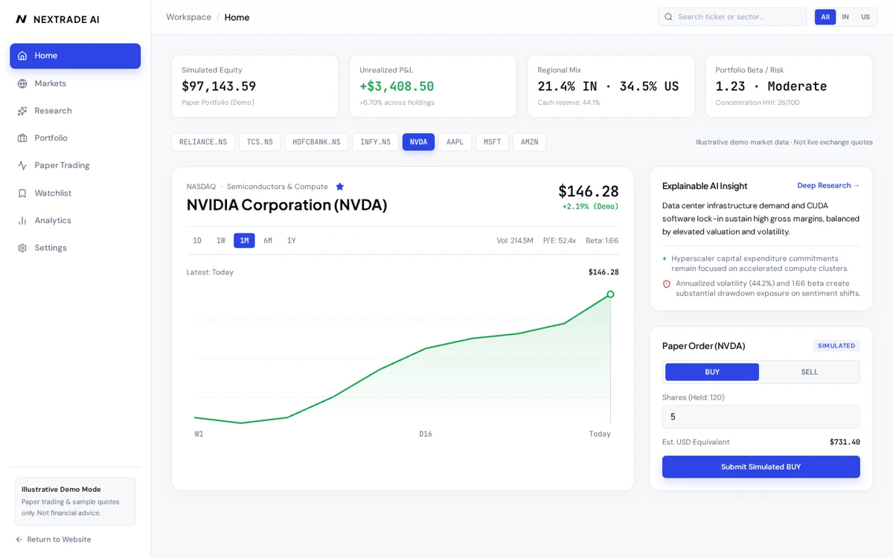
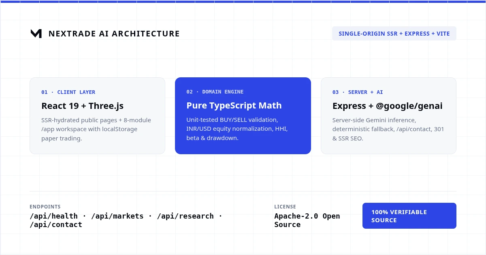

<div align="center">

# Nextrade AI

**Open-Source Financial Intelligence, Market Research & Simulated Paper Trading Platform**

Built by Meril & NEXORA Labs · Licensed under Apache-2.0

[](https://www.typescriptlang.org/)
[](https://react.dev/)
[](https://vite.dev/)
[](https://expressjs.com/)
[](https://supabase.com/)
[](#license)



</div>

---

## Overview

**Nextrade AI** is a full-stack TypeScript web platform combining:

1. **Server-Side Rendered Public Website** (`/`, `/product`, `/features`, `/markets`, `/research`, `/paper-trading`, `/docs`, `/status`) with SEO metadata, Schema.org JSON-LD, dynamic `/robots.txt` & `/sitemap.xml`, and a browser-only public paper-trading simulator.
2. **Authenticated Multi-User Workspace** (`/app`, `/app/account`, `/app/security`) with isolated per-user portfolios, holdings, watchlists, server-priced simulated `$100,000` paper trading, Gemini AI financial research briefs, saved research reports, and self-service privacy exports/deletions.
3. **Six-Phase Admin Control Centre** (`/admin/*`) providing role-based operational governance across users, sessions, AI prompt & policy versioning, market providers, telemetry observability, alerts & incidents, privacy queues, backups, feature flags, releases, maintenance windows, governed automation, dual-control approvals, and emergency controls.

> **Disclaimer:** Nextrade AI is an informational and educational platform. Paper trading operates exclusively on simulated virtual cash (`$100,000` starting balance) and does not execute real brokerage orders or provide financial or investment advice.

---

## Key Features

### Market Data & Caching
- **Real Market Feeds (No Synthetic Prices):** Fetches quotes, symbol search, historical OHLCV series, and FX rates from Yahoo Finance, CoinGecko, and Frankfurter (ECB FX) out of the box—plus optional Finnhub integration for US equities.
- **Two-Tier Cache & Fail-Closed Degradation:** In-memory L1 cache backed by database L2 cache tables (`market_quote_cache`, `market_history_cache`, `market_fx_cache`), degrading cleanly to `CACHED` or `UNAVAILABLE` (`price: null`) when upstream providers fail.

### Authenticated Workspace & Simulated Paper Trading
- **Multi-User Isolation:** Every `/api/workspace/*` route requires an authenticated session and scopes reads/writes strictly by `user_id`.
- **Portfolios & Watchlists:** Create up to 10 portfolios and 10 watchlists (50 symbols each), track multi-currency holdings (USD & INR), and migrate legacy browser drafts via one-time import.
- **Paper Trading Engine:** Server-side quote & USD/INR FX resolution, transactional execution (`pg_advisory_xact_lock` on PostgreSQL / `BEGIN IMMEDIATE` on SQLite), `clientOrderId` idempotency, order/transaction ledgers, and account reset.

### Gemini AI Financial Research
- **Structured Explainable Briefs:** Powered by `@google/genai` with strict JSON schema output, server-enforced disclaimers, prompt-injection/PII input inspection, and versioned admin-managed system prompts and safety policies.
- **Fail-Closed AI Building Mode:** When `GEMINI_API_KEY` is unconfigured or AI capabilities are disabled, endpoints return structured `503` status payloads instead of fabricated responses.

### Authentication, RBAC & Privacy Governance
- **Security Primitives:** Argon2id password hashing (with timing-mitigated login), SHA-256 hashed opaque `HttpOnly` session cookies (`nextrade_session`), single-use email verification & password reset tokens, and password re-authentication (`428`/`403`) on sensitive admin operations.
- **8-Role RBAC Hierarchy:** `user`, `viewer`, `support_admin`, `data_admin`, `ai_admin`, `security_admin`, `admin`, and `super_admin`.
- **Self-Service Privacy (`/api/privacy/*`):** Personal data inventory summary, HMAC-signed JSON export bundles, and grace-period deletion request/cancellation workflows.

---

## Tech Stack

| Layer | Technologies |
|---|---|
| **Frontend** | React 19, TypeScript (ESM), Vite 8 (Client + SSR), Tailwind CSS v4, Motion, Lucide Icons, Three.js |
| **Backend** | Node.js 22+, Express 4, custom SSR renderer (`src/entry-server.tsx`), `tsx` |
| **Database** | Supabase PostgreSQL (`postgres` PgBouncer-compatible driver) with automatic local `node:sqlite` fallback |
| **Authentication** | `argon2` (Argon2id), `node:crypto` (CSPRNG tokens & SHA-256/HMAC), EmailJS / Resend |
| **AI & Market Data** | `@google/genai` (Gemini), Yahoo Finance, CoinGecko, Frankfurter ECB FX, optional Finnhub |
| **Testing** | Built-in `node:test` + `node:assert/strict` (12 unit & integration suites) |

---

## Architecture & Project Structure

<div align="center">

</div>

```text
.
├── server.ts                  # Express server, security headers/CSP, SSR catch-all, public APIs
├── index.html                 # HTML shell with <!--ssr-meta--> and <!--ssr-outlet--> slots
├── vite.config.ts             # Vite 8 + React + Tailwind v4 configuration
├── .env.example               # Environment variable template
├── migrations/
│   ├── 0001..0007*.sql        # SQLite up/down schema migrations (58 tables)
│   └── postgres/
│       └── 0001..0007*.sql    # PostgreSQL up/down schema migrations (58 tables)
├── public/                    # Static public brand assets, OG images, robots/sitemap
└── src/
    ├── main.tsx               # Client React hydration entrypoint
    ├── entry-server.tsx       # SSR renderToString entrypoint
    ├── App.tsx                # SPA/SSR router, SEO head management, layout shell
    ├── auth/                  # DB adapters (Postgres/SQLite), Argon2id, sessions, RBAC, email
    ├── workspace/             # Authenticated workspace router, paper trading & portfolio service
    ├── market/                # Multi-provider market data connectors, catalog, L1/L2 cache
    ├── admin/                 # Phases 3–6 Admin Control Centre routers, services, telemetry, bootstrap
    ├── lib/                   # Shared security utilities, Gemini research engine, portfolio math, API clients
    └── components/            # Public pages, auth flows, workspace app, and 25 admin console views
```

---

## Quick Start (Local Development)

### Prerequisites
- **Node.js v22.14+** (required for built-in `node:sqlite`)
- **npm** (or **Bun**)

### 1. Clone & Install Dependencies

```bash
git clone https://github.com/MERIL2026/Nextrade-ai-website.git
cd Nextrade-ai-website
npm install
```

### 2. Configure Environment Variables

Copy `.env.example` to `.env`:

```bash
cp .env.example .env
```

- **Fastest local start (SQLite):** Leave `DATABASE_URL=""` and `SUPABASE_DB_URL=""` blank. The server automatically initializes `.data/nextrade-auth.sqlite` and runs all 7 migrations on startup.
- **Live AI Research:** Set `GEMINI_API_KEY` to a valid Google Gemini API key (leave default placeholder to run in AI Building Mode).
- **Local Email Testing:** Set `AUTH_DEV_OUTBOX="true"` in development to capture verification and password-reset emails as JSON under `.data/dev-email-outbox/`.

### 3. Start the Development Server

```bash
npm run dev
```

The application starts on `http://localhost:3000`.

### 4. Production Build & Run

```bash
npm run build
NODE_ENV=production npx tsx server.ts
```

> **Note:** `npm run build` outputs the client bundle to `dist/` and SSR server bundle to `dist/server/`. Because `server.ts` uses TypeScript source imports, run production with `tsx` (e.g., `NODE_ENV=production npx tsx server.ts`) or Bun (`NODE_ENV=production bun server.ts`).

---

## Environment Variables

See [.env.example](.env.example) for the full template.

| Variable | Required | Description |
|---|---|---|
| `APP_URL` | Recommended | Canonical HTTPS origin used for SSR canonical URLs, email verification links, and CSRF origin checks. |
| `GEMINI_API_KEY` | Optional | Google Gemini API key for live AI research briefs (fails closed in AI Building Mode when unset). |
| `DATABASE_URL` / `SUPABASE_DB_URL` | Optional | PostgreSQL connection URI (Supabase Transaction Pooler `:6543` uses username `postgres.<project-ref>`). Falls back to SQLite when blank. |
| `AUTH_DB_PATH` | Optional | SQLite database file path (default: `.data/nextrade-auth.sqlite`). |
| `EXPORT_SIGNING_SECRET` | Recommended (Prod) | High-entropy secret (>= 32 bytes) used to sign privacy export download URLs. |
| `EMAIL_PROVIDER` | Optional | `emailjs` (default) or `resend`. Configure matching `EMAILJS_*` or `EMAIL_API_KEY` / `EMAIL_FROM` keys. |
| `AUTH_DEV_OUTBOX` | Optional (Dev) | Set `"true"` in non-production to write outgoing auth emails to `.data/dev-email-outbox/`. |
| `ADMIN_BOOTSTRAP_EMAIL` / `_PASSWORD` / `_NAME` | Optional | Server-side initial `super_admin` bootstrap (runs only when zero active `super_admin` accounts exist). |
| `FINNHUB_API_KEY` | Optional | Adds Finnhub as an extra US equity quote source (Yahoo Finance, CoinGecko, and Frankfurter require no keys). |
| `GA_MEASUREMENT_ID` | Optional | Consent-gated Google Analytics 4 measurement ID. |

### Bootstrapping the First Super Admin

Either set `ADMIN_BOOTSTRAP_EMAIL` and `ADMIN_BOOTSTRAP_PASSWORD` in `.env` on initial boot, or run the CLI bootstrapper:

```bash
npx tsx src/admin/bootstrap.ts
```

---

## Database & Migrations

Migrations run automatically on startup via `src/auth/db.ts`:
- **PostgreSQL (`migrations/postgres/0001..0007.sql`):** Enabled automatically when `DATABASE_URL` or `SUPABASE_DB_URL` is a valid `postgres://` or `postgresql://` URI. Configured with `prepare: false` and `max_pipeline: 1` for Supabase PgBouncer Transaction Pooler compatibility.
- **SQLite (`migrations/0001..0007.sql`):** Enabled automatically when no PostgreSQL URI is set (and used by all offline integration test suites).

---

## Available Scripts & Testing

| Command | Description |
|---|---|
| `npm run dev` | Start Express + Vite SSR development server (`http://localhost:3000`) |
| `npm run build` | Build production SPA (`dist/`) and SSR bundle (`dist/server/`) |
| `npm run lint` | Run TypeScript typechecking (`tsc --noEmit`) |
| `npm run preview` | Preview built client assets via Vite |

Run the full offline unit and integration test suite (12 suites using `:memory:` / temp SQLite and mocked external adapters):

```bash
npx tsx --test \
  src/lib/authValidation.test.ts \
  src/lib/portfolioEngine.test.ts \
  src/lib/security.test.ts \
  src/lib/siteData.test.ts \
  src/market/marketService.test.ts \
  src/auth/auth.test.ts \
  src/auth/rbac.test.ts \
  src/workspace/workspace.test.ts \
  src/admin/admin.test.ts \
  src/admin/phase4.test.ts \
  src/admin/phase5.test.ts \
  src/admin/phase6.test.ts
```

---

## Security Notes

- Never commit `.env`, `.data/`, or local SQLite database files (excluded via `.gitignore`).
- For Supabase PostgreSQL deployments, ensure Row-Level Security (RLS) is enabled and `anon`/`authenticated` PostgREST table grants are revoked on `public` schema tables if Supabase Data APIs are enabled.
- Always configure `APP_URL`, `NODE_ENV=production`, and a dedicated high-entropy `EXPORT_SIGNING_SECRET` in production deployments.
- See [PRODUCTION_ENVIRONMENT_SETUP.md](PRODUCTION_ENVIRONMENT_SETUP.md) for deployment checklists.

---

## License

Nextrade AI is open-source software licensed under the **Apache License 2.0**.
